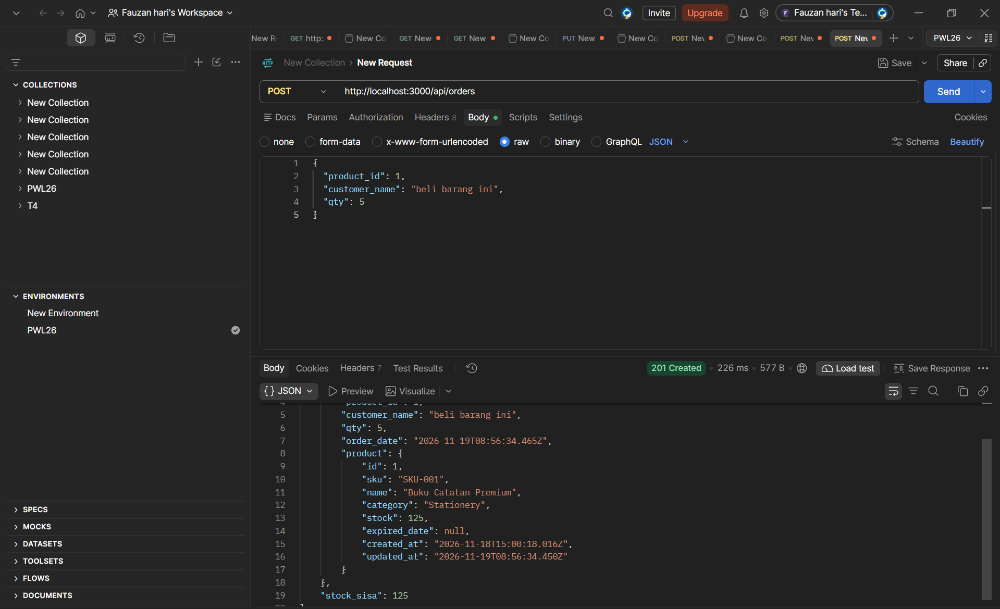
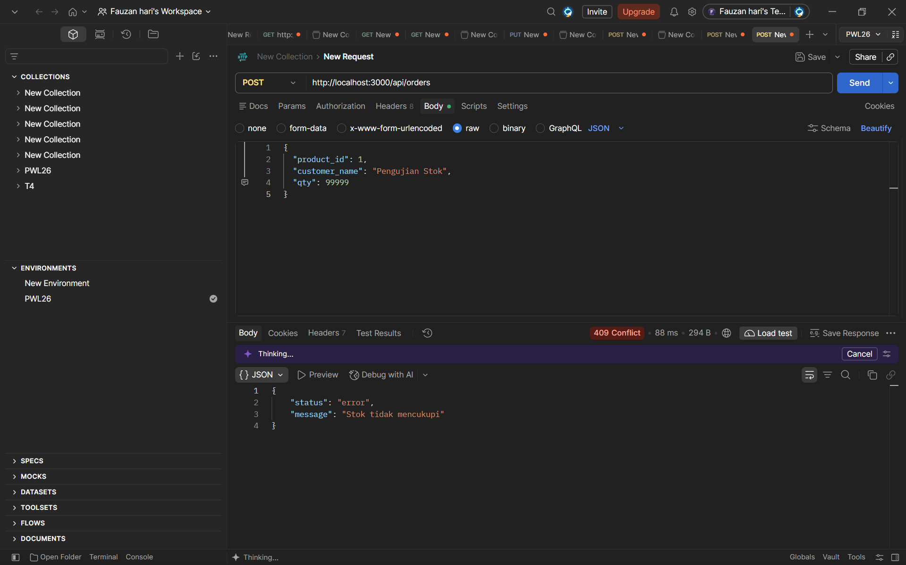
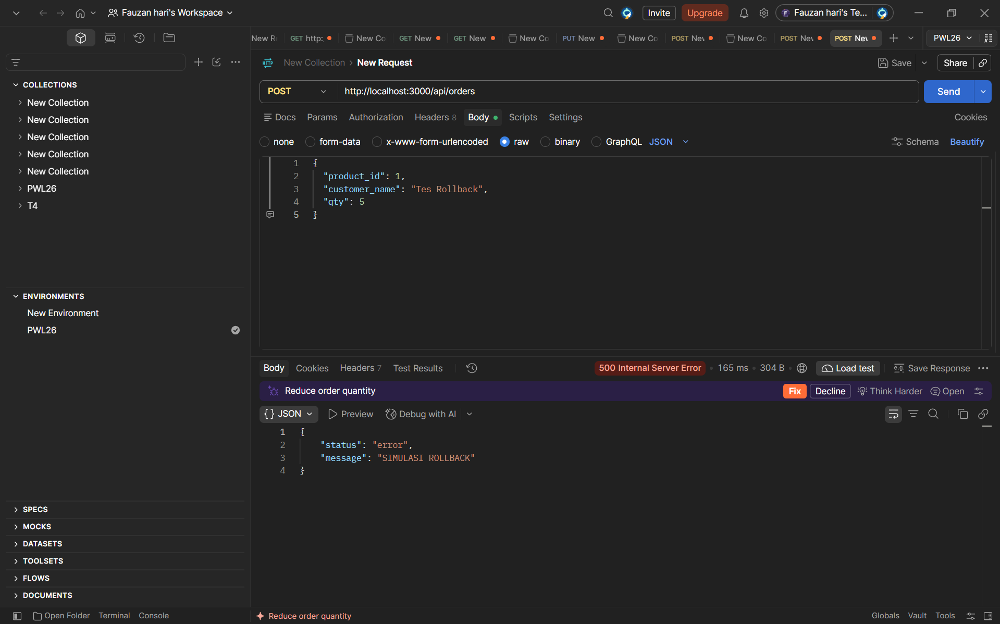
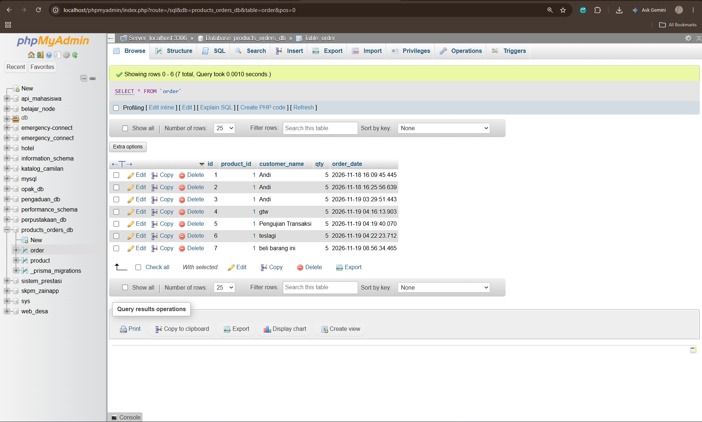
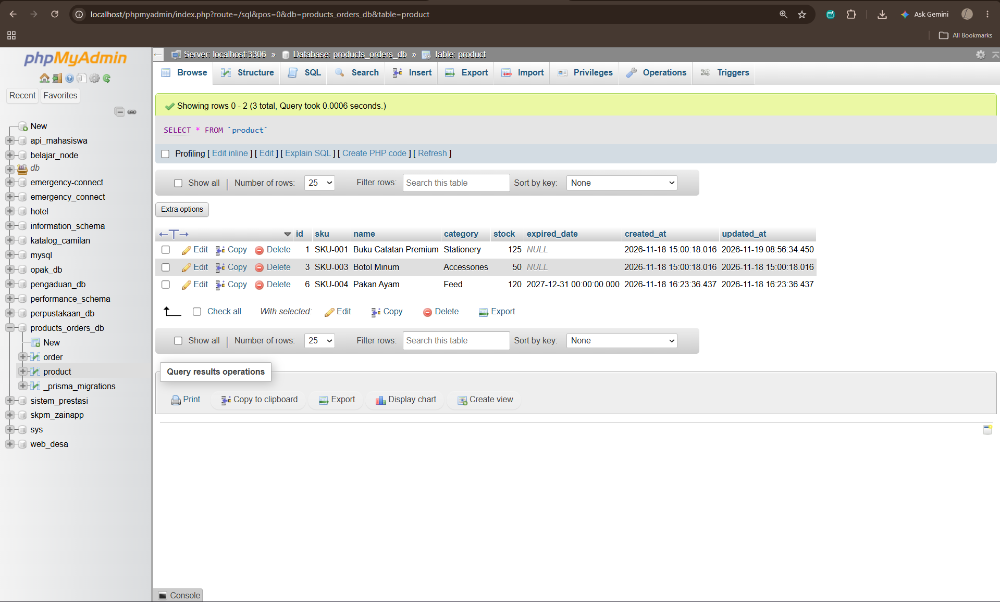

# Products & Orders REST API

## Identitas

- **Nama:** Fauzan Hari Ramdani
- **NIM:** F1D02410047
- **Mata Kuliah:** PWEB LANJUT
- **Kelas:** C
- **LINK YOUTUBE: :** lagi di upload pak bentar...

## Deskripsi Project

Project ini merupakan REST API untuk mengelola data Product dan Order menggunakan Express.js, TypeScript, Prisma ORM, dan MySQL.

Pada proses pembuatan Order, sistem menggunakan Prisma Transaction untuk menjalankan dua operasi database:

1. Menambahkan data Order.
2. Mengurangi stok Product sesuai jumlah pesanan.

Transaction menjaga konsistensi data. Jika salah satu operasi gagal, seluruh perubahan dalam transaksi dibatalkan melalui rollback.

## Teknologi

- Node.js
- Express.js
- TypeScript
- Prisma ORM
- MySQL
- Joi
- Postman

## Cara Menjalankan

### 1. Install dependencies

```bash
npm install
```

### 2. Buat database MySQL

```sql
CREATE DATABASE products_orders_db;
```

Sesuaikan `.env` dengan konfigurasi MySQL lokal:

```env
DATABASE_URL="mysql://root:@localhost:3306/products_orders_db"
```

Sesuaikan username, password, dan nama database.

### 3. Migrasi database

```bash
npx prisma migrate dev
```

### 4. Seed database (jika tersedia)

```bash
npx prisma db seed
```

### 5. Jalankan server

```bash
npm run dev
```

## Endpoint API

Base URL: `http://localhost:3000/api`

### Products

| Method | Endpoint        | Fungsi                             |
| ------ | --------------- | ---------------------------------- |
| GET    | `/products`     | Menampilkan seluruh Product        |
| GET    | `/products/:id` | Menampilkan Product berdasarkan ID |
| POST   | `/products`     | Menambahkan Product                |
| PUT    | `/products/:id` | Memperbarui Product                |
| DELETE | `/products/:id` | Menghapus Product                  |

### Orders

| Method | Endpoint      | Fungsi                                    |
| ------ | ------------- | ----------------------------------------- |
| GET    | `/orders`     | Menampilkan seluruh Order                 |
| GET    | `/orders/:id` | Menampilkan Order berdasarkan ID          |
| POST   | `/orders`     | Membuat Order dan mengurangi stok Product |

## Pengujian Transaction

### 1. Transaksi Berhasil

**Request:** `POST /api/orders`

```json
{
  "product_id": 1,
  "customer_name": "Pengujian Transaksi",
  "qty": 5
}
```

Hasil yang diharapkan:

- Order berhasil dibuat.
- Stok Product berkurang 5.
- HTTP `201 Created`.

### 2. Stok Tidak Mencukupi

```json
{
  "product_id": 1,
  "customer_name": "Pengujian Stok",
  "qty": 99999
}
```

Hasil yang diharapkan:

- Order tidak dibuat.
- Stok tidak berubah.
- HTTP `409 Conflict`.

### 3. Pengujian Rollback

Rollback diuji dengan menambahkan simulasi error di dalam transaction setelah proses pembuatan Order dan pengurangan stok.

Hasil yang diharapkan:

- Transaksi gagal.
- Order tidak tersimpan.
- Stok tidak berubah.

## Screenshot Pengujian

### 1. Transaksi Berhasil



### 2. Stok Tidak Mencukupi



### 3. Pengujian Rollback



### 4. Database Order



### 5. Database Product



## Deklarasi Penggunaan AI

Dalam pengerjaan project ini, saya menggunakan AI sebagai alat bantu belajar dan pendukung pengerjaan, terutama untuk memahami konsep REST API, Prisma Transaction, debugging, serta memperoleh saran struktur dan implementasi kode.

Project tidak sepenuhnya dikerjakan oleh AI. Saya turut melakukan penyesuaian kode, memahami alur program, mengimplementasikan perubahan, menjalankan aplikasi, menguji endpoint menggunakan Postman, serta memeriksa hasil transaksi pada database.

Penggunaan AI sebagai bantuan dan referensi, sedangkan sisanya merupakan proses pemahaman, penyesuaian, implementasi, dan pengujian yang saya lakukan sendiri. Saya bertanggung jawab atas kode, hasil pengujian, dan pemahaman terhadap implementasi project ini.
